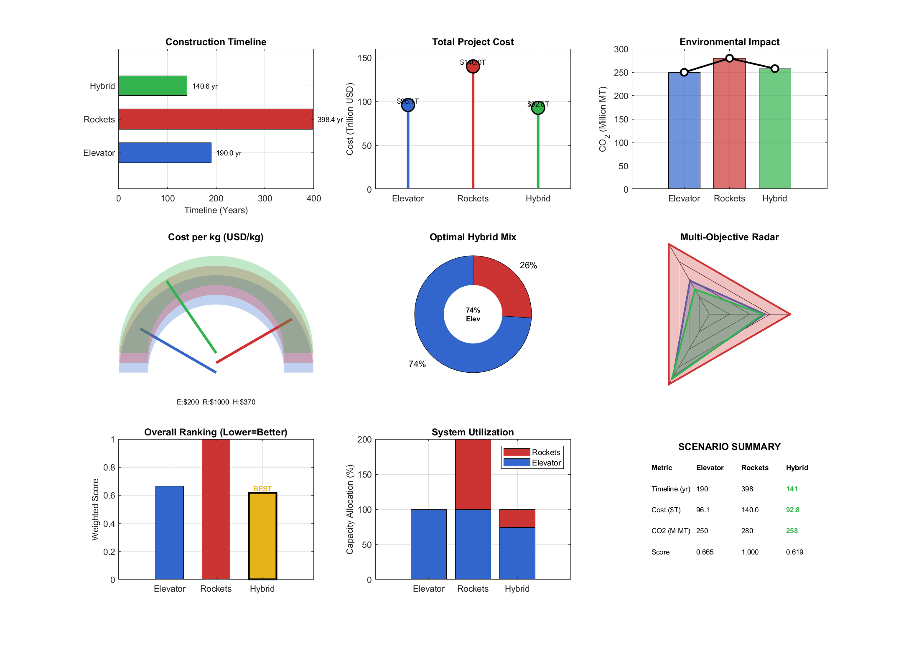

# 2026 MCM B｜月球殖民地运输规划

**Meritorious Winner（M 奖） · Team 2600039 · 重庆邮电大学**

2026 年美国大学生数学建模竞赛（MCM）B 题：**Creating a Moon Colony Using a Space Elevator System**。比较太空电梯、火箭及混合运输方案，分析建设运输、随机故障、持续供水与环境影响。

**[阅读完整论文 PDF](paper/2600039.pdf)** · [LaTeX 源码](paper/latex/document.tex) · [MATLAB 代码](matlab) · [官方获奖结果（第 13 页）](https://contest.comap.com/undergraduate/contests/mcm/contests/2026/results/2026_MCM_Problem_B_Results.pdf#page=13) · [官方题目](https://contest.comap.com/undergraduate/contests/mcm/contests/2026/problems/index.html)

## 论文

**Reaching for the Stars: A Multi-Objective Optimization Framework for Lunar Colony Transportation**

Team 2600039，2026 MCM Problem B，26 页（含 AI 使用报告）。公开 PDF 保留本地队号命名版本的原始字节；LaTeX 为归档工作源码，未在本次发布中重新编译。论文与代码为团队竞赛成果。



## 方法与文件

| 文件 | 内容 |
| --- | --- |
| `matlab/MCM_ProblemB_Visualizations.m` | 综合分析与图表生成，覆盖运输方案、可靠性、供水和环境影响 |
| `matlab/problem1.m` | 可靠性分析历史版本；文件名为原始归档名，并非第 1 问求解器 |
| `matlab/problem2.m` | 可靠性分析重写版本，使用蒙特卡洛模拟 |
| `matlab/problem3.m` | 十万人月球殖民地供水需求与运输分析 |
| `matlab/problem4.m` | 环境影响分析与减排方案 |
| `results/`、`figures/` | 历史结果、MAT 数据、CSV 和图表 |
| `paper/latex/` | 论文源码及所引用图片 |

## 使用

使用 MATLAB；`normrnd` 等函数需要 Statistics and Machine Learning Toolbox。不同历史脚本可独立打开运行，不需要依次执行全部文件。脚本会清空工作区、关闭图窗；建议在单独 MATLAB 会话和输出目录运行。

```matlab
% 在仓库根目录启动 MATLAB
repo = pwd;
mkdir('output');
cd('output');
run(fullfile(repo, 'matlab', 'MCM_ProblemB_Visualizations.m'));
```

论文源码可在 `paper/latex` 目录用完整 TeX Live / MiKTeX 环境编译，例如 `latexmk -pdf document.tex`。

本次发布完成文件整理、论文检查与源码静态核对，未重新运行 MATLAB 或编译论文。历史脚本存在不同模型版本，不能假定所有输出与论文逐项一致；随机模拟结果也可能变化。文中数值是竞赛假设下的模型结果，不是实际航天工程验证。

## 引用与许可

引用时请注明 Team 2600039、论文题名与 2026 MCM Problem B，并链接本仓库。MATLAB 原创代码采用 [MIT License](LICENSE)；论文、论文插图及历史结果保留原作者权利，公开用于阅读与学术交流，不纳入代码许可证。COMAP 题面使用官方链接。
